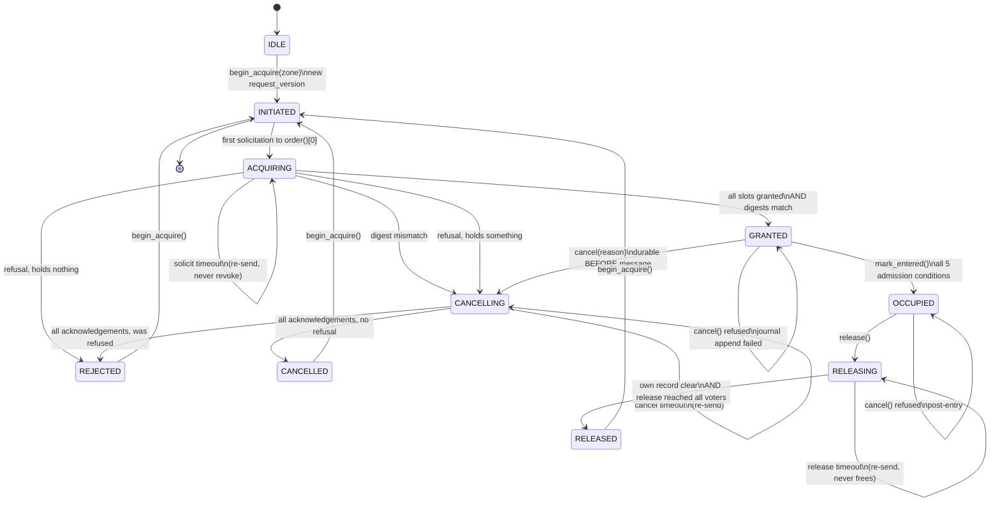
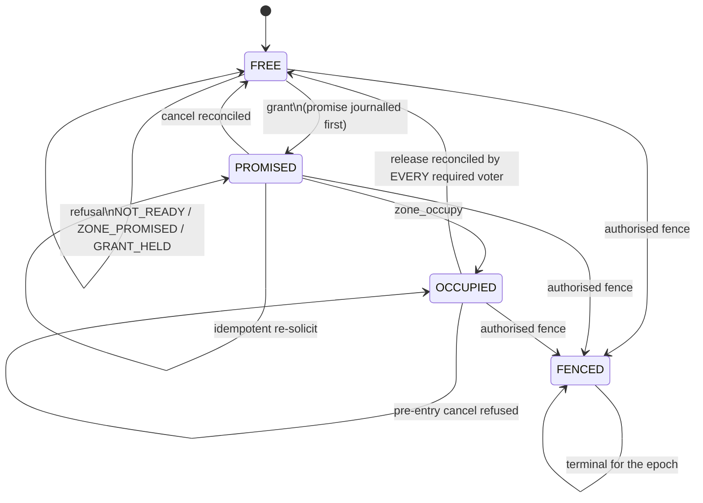

# NĪHĀRAMESH Exclusive-Zone Protocol

Status: implemented. Specification of record for the coordination layer in
`src/niharamesh/coordination/`. An independent reviewer should read this file
next to that code and treat any disagreement as a defect in one of them.

Evidence category: **implemented and verified** for every rule marked *tested*
below. The commands and their output are recorded in `docs/STATUS.md`; nothing
here is a measured physical result. All numbers quoted are *configured
assumptions* from `SimulationConfig` / `ProtocolTiming`, not measurements.

Decisions of record:

- [`docs/adr/0002-canonical-sequential-acquisition.md`](../adr/0002-canonical-sequential-acquisition.md)
- [`docs/adr/0003-single-outstanding-grant.md`](../adr/0003-single-outstanding-grant.md)

---

## 1. Scope and vocabulary

The protocol answers exactly one question: **may this robot cross the stop line
into zone Z right now, and if not, why not?** It does not plan routes, allocate
tasks, or decide when a robot should want a zone. Those are the planner's and the
auction's jobs.

| Term | Meaning here |
|---|---|
| **zone** | An exclusive resource with disjoint protected geometry (`domain.map.Zone`). `FREE`, `PROMISED`, `OCCUPIED`, `FENCED`. |
| **requester** | One zone transaction, owned by one robot, identified by `transaction_id(run_id, request_version, zone_id, requester)`. |
| **voter** | The authority store of one robot for one zone. Every robot is a voter for every zone. |
| **walk** | A requester's sequential acquisition of the required voters. |
| **required set** | Every admitted member, ascending `robot_id`. Canonical order is `Membership.order()`. |
| **canonical index zero** | The voter with the lowest `robot_id`. Every walk starts here. |
| **grant set** | The promises a requester holds. It is executable only when it is the complete required set. |
| **required-set digest** | SHA-256 over the ascending `(robot_id, session_id, grant_id)` triples of the whole required set. |
| **executable** | A state from which physical entry is permitted. Exactly one: `GRANTED`, then `OCCUPIED`. |

Nothing in this document is a claim about collision-freedom in general. It is a
claim about one specific mechanism, under the assumptions in sections 11 and 12.

---

## 2. Actors

Each robot process runs one `ZoneProtocol`, which plays **both** roles
simultaneously:

- **as a voter**, for every peer and every zone: it decides whether to promise,
  and records what it promised durably;
- **as a requester**, for at most one zone at a time: it walks the canonical order
  and decides whether it may enter.

Authority boundaries (invariant 1):

- The simulator never grants. It applies commands.
- The API never coordinates. It reads each robot's own published state.
- The safety gate vetoes motion; it never grants a zone.
- A robot reads only: its own observations, the immutable shared map, the task
  feed, and actual peer messages. It never reads another robot's pose, its zone
  state, or the evaluator's verdict.

The implementation has no sockets and no event loop. `ZoneProtocol.tick(now_ns)`
drives everything; `ZoneProtocol.outbox` is a list of `(peer_id, PeerMessage)`
pairs that the transport drains.

---

## 3. Canonical sequential acquisition

Let the admitted members, in canonical order, be `c_0 < c_1 < ... < c_{n-1}`
(ascending `robot_id`). `Membership.quorum()` is `n`: the required set is
**all** members.

A requester for zone `Z`:

```
slot[0] = c_0   slot[1] = c_1   ...   slot[n-1] = c_{n-1}
```

1. **One outstanding solicitation at a time.** It sends `ZoneRequestBody` to
   `slot[cursor]` and waits. It does not pre-solicit, batch, or speculate.
2. **On a grant** for `slot[cursor]`, it advances `cursor` and solicits the next.
3. **On an explicit refusal** it stops. It does not skip ahead.
4. **Its own local voter is not privileged.** For the requester whose
   `robot_id == c_0`, `slot[0]` is itself; the request is evaluated in-process by
   exactly the same code, in the same position, with the same rules. There is no
   `pre-reserve your own grant first` path anywhere in the implementation.
   *Why this matters:* if the lowest-index robot took its own grant first and
   everybody else started at `c_1`, then `c_0`'s voter could hand out two
   promises for one zone and the wait-for graph could close a cycle. Starting
   everyone at `c_0` makes `c_0` the single serialisation point for the zone.
5. **`GRANTED` is reached only when** every slot is `VoterSlotState.GRANTED`
   **and** every advertised `required_set_digest` equals the digest the requester
   computes locally. A mismatch is a protocol error: the transaction is durably
   cancelled and never becomes executable.

**Admission (`may_enter`) requires all five, and reports which one failed:**

| # | Condition | Failure report |
|---|---|---|
| 1 | phase is exactly `GRANTED` | `idle` / `partial_acquisition` |
| 2 | the grant set is the exact complete required set | `partial_acquisition` |
| 3 | every advertised digest equals the locally computed digest | `digest_mismatch` |
| 4 | durable commitment: the journal appended an `entry_commit` record and is healthy | `journal_unavailable` |
| 5 | current local safety check permits, and no required peer's claim is suspended | `safety_gate` / `peer_state_stale` |
| + | the requester holds no other outstanding transaction (invariant 6) | enforced by `ZoneRequester.begin` |

### 3.1 Queue fairness

Each voter keeps a bounded, in-memory **fairness queue** per zone, ordered by
arrival. It is ordering only, never authority:

- a refused requester joins the queue and is told its position;
- when the zone is free, the voter serves the **queue head**, not whoever arrived
  first;
- a retry keeps the position it already had;
- an entry expires after `4 × solicit_timeout_s`. That expires *permission to
  assume the head will return*, never occupancy and never an issued promise.

Without this, canonical sequential acquisition is **structurally monopolised by
the lowest-index robot**: it reaches `c_0` in zero round trips and everybody else
needs one. Section 6.5 shows what that costs and why the queue is not optional.

---

## 4. States

### 4.1 Owner side — `AcquisitionPhase`

Exactly these eleven, from `domain/coordination.py`. No other value exists.

`INITIATED`, `ACQUIRING`, `GRANTED`, `CANCELLING`, `CANCELLED`, `OCCUPYING`,
`OCCUPIED`, `RELEASING`, `RELEASED`, `REJECTED`, `FAILED`.

### 4.2 Owner side — complete allowed transition table

Terminal states: `CANCELLED`, `RELEASED`, `REJECTED`, `FAILED`. Only a
**new** transaction (next `request_version`) leaves a terminal state; a new
priority means a safely cancelled old request and a new identity, never a
mutation of an outstanding order.

| # | From | Trigger | Guard | To | Side effect (durable first) |
|---|---|---|---|---|---|
| T1 | `IDLE` | `begin_acquire(zone)` | zone in the immutable map; membership digest present | `INITIATED` | `request_version` = last + 1 for `(zone, requester)` |
| T2 | `INITIATED` | `tick` | — | `ACQUIRING` | emits `zone_request` to `slot[0]`; local voter handled in-process |
| T3 | `ACQUIRING` | `zone_grant` for `slot[cursor]` | `grant_id` matches; phase is `ACQUIRING`; not durably non-executable | `ACQUIRING` | records `persistence_record_id` + advertised digest; `cursor++` |
| T4 | `ACQUIRING` | last grant received, all digests equal the computed digest | complete set **and** digest match | `GRANTED` | entry commitment written lazily by `may_enter` |
| T5 | `ACQUIRING` | last grant received, any digest differs | — | `CANCELLING` | `cancel` journalled with `durably_non_executable=true`, reason `grant_set_digest_mismatch` |
| T6 | `ACQUIRING` | explicit refusal (negative acknowledgement) | **no** grants held | `REJECTED` | refusal recorded locally with its `RejectionReason`; retry scheduled |
| T7 | `ACQUIRING` | explicit refusal | ≥1 grant held | `CANCELLING` | as T5, reason `refused:<reason>` |
| T8 | `ACQUIRING` | solicit timeout | — | `ACQUIRING` | **re-sends the same bytes**; never revokes, never reorders |
| T9 | `CANCELLING` | `zone_cancel_ack` from every peer that ever granted | no grants held **and** no peer left to reconcile | `CANCELLED` | — |
| T10 | `CANCELLING` | same, but the attempt was refused | as T9 | `REJECTED` | retry scheduled |
| T11 | `CANCELLING` | `zone_grant` arrives late | — | `CANCELLING` | **T-LATE**: logged `LATE_GRANT_IGNORED`, voter added to the reconcile set, no authority created |
| T12 | `CANCELLING` | cancel timeout | — | `CANCELLING` | re-sends `zone_cancel`; never revokes |
| T13 | `GRANTED` | `cancel(reason)` | journal append succeeded | `CANCELLING` | `cancel_seq++`, durable non-executable **before** any message |
| T14 | `GRANTED` | `cancel(reason)` | journal append failed | `GRANTED` | `CANCEL_NOT_DURABLE` logged; the request stays executable, and the reason is that durability is unavailable, not that cancellation is optional |
| T15 | `GRANTED` | `mark_entered` and `may_enter` | all five admission conditions | `OCCUPIED` | `occupancy` record; `zone_occupy` to every required voter |
| T16 | `OCCUPYING` / `OCCUPIED` / `RELEASING` | `cancel(reason)` | — | unchanged | `CANCEL_REFUSED_POST_ENTRY`; the robot may physically be inside |
| T17 | `OCCUPIED` | `release()` | `release` record appended | `RELEASING` | `zone_release` to every required voter |
| T18 | `RELEASING` | local voter record cleared **and** the release reached every required voter | — | `RELEASED` | owner closes its books; the authoritative `FREE` state lives at each voter |
| T19 | `RELEASING` | release timeout | — | `RELEASING` | re-sends `zone_release`; never frees anything |
| T20 | terminal | `begin_acquire(zone)` | — | `INITIATED` | new `request_version` |
| T21 | any non-terminal | boot with corrupt journal | — | unchanged | `stopped`, `degraded`, `may_enter` false forever |
| T22 | `IDLE` / any | `stopped in unknown_stopped` | journal unhealthy or unattributable record | — | refuses to begin: `NOT_READY` |

**T-LATE (the required late-grant rule).** A `zone_grant` that arrives after the
owner has durably written `durably_non_executable` is:

1. recorded in the event log as `LATE_GRANT_IGNORED`,
2. **never** recorded as a held grant, never counted by `may_enter`,
3. **answered** with a `ZoneCancelBody` for that `grant_id`, so the voter's
   record converges.

Tested by `tests/protocol/test_cancellation.py::test_late_grant_after_durable_cancellation_is_ignored`.

### 4.3 Voter side — `ZoneState` transition table

Exactly four states. The voter holds one `ZoneRecord` per zone.

| # | From | Trigger | Guard | To | Side effect |
|---|---|---|---|---|---|
| V1 | `FREE` | `solicit` | all admission checks pass; head of the fairness queue; journal healthy; append succeeded | `PROMISED` | `promise` record written **before** the grant is returned |
| V2 | `FREE` | `solicit` | journal unhealthy, or append returned no record id | `FREE` | refusal `NOT_READY`; **no promise exists** |
| V3 | `FREE` | `solicit` | any required member's boot id unknown | `FREE` | refusal `NOT_READY` ("the required set cannot be hashed") |
| V4 | `PROMISED` | `solicit`, identical `(grant_id, requester_session, request_version)` | idempotent re-solicit | `PROMISED` | re-grant with the **same** `persistence_record_id` |
| V5 | `PROMISED` | `solicit`, different transaction | queue position assigned | `PROMISED` | refusal `ZONE_PROMISED` + position; durable `refusal` record |
| V6 | `PROMISED` | `solicit`, requester already owed a promise for another zone | P2 | `PROMISED` | refusal `GRANT_HELD` |
| V7 | `PROMISED` | `solicit` for a fenced zone | — | `FENCED` | refusal `ZONE_FENCED` |
| V8 | `PROMISED` | `zone_cancel` with `cancel_seq` greater than the record's | — | `FREE` | `cancel` record; the record is dropped |
| V9 | `PROMISED` | `zone_cancel` with a stale or equal `cancel_seq` | idempotency | `PROMISED` | ack echoes the record's `cancel_seq`; nothing changes |
| V10 | `PROMISED` | `zone_occupy` with `occupancy_seq ≥` the record's | grant id matches | `OCCUPIED` | `occupancy` record |
| V11 | `PROMISED` | `zone_occupy` with a stale `occupancy_seq` | — | `PROMISED` | ignored; never applied backwards |
| V12 | `OCCUPIED` | `zone_release` matching the grant | — | `OCCUPIED` | `release_intent` record, `released_by += sender`, relayed onward |
| V13 | `OCCUPIED` | release reconciled by **every** required voter | full consensus | `FREE` | the record is dropped; the zone is free |
| V14 | `OCCUPIED` | `zone_cancel` (pre-entry cancellation) | — | `OCCUPIED` | refusal `PROTOCOL_VIOLATION`, durable `durably_non_executable`; **the aisle is not emptied** |
| V15 | `OCCUPIED` / `PROMISED` | `zone_release` | grant id does not match, or no record | unchanged | ignored (evidence for nothing) |
| V16 | any non-`FENCED` | `zone_fence` with `operator_authorised = true` | zone is on this robot's map | `FENCED` | `fence` record with `previous_holder`, `previous_requester_session`, `reason` |
| V17 | `FENCED` | `zone_fence` again | — | `FENCED` | idempotent |
| V18 | `FENCED` | anything else | — | `FENCED` | **terminal for the epoch**; every later `solicit` is `ZONE_FENCED` |
| V19 | any | `zone_fence` with `operator_authorised = false` | — | unchanged | refusal `PROTOCOL_VIOLATION`: "there is no force release" |

---

## 5. Messages

All bodies are defined in `src/niharamesh/domain/coordination.py`, which is the
authoritative wire contract. This section only states who sends what and what the
sender must have already done.

| Envelope `kind` | Sender → | Body | Precondition on the sender |
|---|---|---|---|
| `zone_request` | requester → one voter | `ZoneRequestBody` | a new or retried `request_version`; the walk is at this index |
| `zone_grant` | voter → requester | `ZoneGrantBody` | **`promise` already appended to the journal** |
| `zone_cancel` | requester → voters that granted (and any late grantor) | `ZoneCancelBody` | **`cancel` already appended with `durably_non_executable = true`** |
| `zone_cancel_ack` | voter → requester | `ZoneCancelAckBody` | a cancellation was reconciled, or refused |
| `zone_cancel_ack` | voter → requester | `ZoneCancelAckBody(no_record = true, cancel_seq = 1)` | **this is also the negative acknowledgement** (section 6.6) |
| `zone_occupy` | requester → every required voter | `ZoneOccupyBody` | the owner has passed `may_enter` and journalled `occupancy` |
| `zone_release` | requester, then relayed by voters → every required voter | `ZoneReleaseBody` | the owner journalled `release_intent` |
| `zone_fence` | any voter → voters | `ZoneFenceBody` | `operator_authorised = true` |

`PeerEnvelope` is checked on every inbound frame in this order, and each failure
has its own `RejectionReason` (§9).

---

## 6. Safety argument

### 6.1 What is claimed

> **S.** In any execution of this protocol, at most one robot at a time holds
> executable authority over any zone, and no robot's own state machine ever holds
> two outstanding grant sets at once.

### 6.2 The five ingredients

- **S1 (durability before acknowledgement).** A `ZoneGrantBody` is emitted only
  after `journal.append("promise", …)` returned a record id (V1). A failed append
  is `NOT_READY` and no promise exists (V2, V3). Therefore any grant a peer holds
  is backed by a durable record at its voter, and a reboot restores it (section 10).
- **S2 (exclusive promise per zone).** A voter promises a zone to at most one
  transaction at a time (V1/V5). It never revokes an issued promise.
- **S3 (the complete required set).** `may_enter` requires *all* voters and a
  matching digest. A partial set is not executable, by construction.
- **S4 (durable cancellation precedes reconciliation).** `durably_non_executable`
  is journalled before any `zone_cancel` is emitted, and a grant arriving after it
  is `LATE_GRANT_IGNORED` (T-LATE).
- **S5 (conservative occupancy).** A zone leaves `OCCUPIED` only on a reconciled
  release from every required voter (V13) or on an authorised fence (V16). No
  timer, heartbeat loss or majority ever empties it.

### 6.3 Why a split grant cannot produce two entries

Suppose two robots both believe they hold the complete required set for `Z` at
the same instant. Both would then hold `c_0`'s promise, because the required set
contains `c_0`. By S2, `c_0` promised `Z` to at most one of them. **Contradiction.**
Two robots cannot both be executable.

This is the direct answer to the brief's warning. The failure mode it describes —
"concurrent requests split durable grants across peers so no robot can enter" — is
unreachable among *conforming* requesters, because a conforming walk acquires
`c_0` first and only one requester can hold `c_0`'s promise for a zone.

**Counterexample, stated honestly.** A *forged* request that skips `c_0` can
create a split: robot `A` holds `c_0`'s promise while robot `B`'s request is
granted by `c_2`, which cannot see `c_0`'s record and must not be told. The
consequence is **fail-stop, not unsafe motion**: neither robot can assemble the
complete set (S3), so neither may enter, and the zone stays blocked until an
operator fences it. This is asserted, not hidden:
`tests/property/test_protocol_state_machine.py::test_a_forged_request_can_split_a_zone_and_the_result_is_fail_stop`.

The one thing the protocol cannot defend against — a *local safety gate* that
lies about a physical obstacle — is out of scope by invariant 7.

### 6.4 One outstanding grant per robot

`AGENTS.md` invariant 6 has two enforcement points:

- **Owner side.** `ZoneRequester.begin` raises `RuntimeError` if this robot
  already has a non-terminal transaction, whatever the zone.
- **Voter side.** A voter that already owes *this requester* a promise refuses a
  new solicitation with `GRANT_HELD` (V6).

Each robot therefore holds at most one grant set, across all zones. This is what
makes the wait-for graph in section 12 acyclic.

### 6.5 The availability cost, stated plainly

- **Every walk needs `n` round trips** (or `n-1`, for the robot at canonical
  index zero, whose own voter answers in-process). A two-round-trip lock service
  is cheaper in the good case.
- **The `GRANT_HELD` rule makes the fleet serialise per robot.** A robot that is
  traversing cannot help itself into a second zone, even a disjoint one.
- **`c_0` is a hot spot.** All acquisition pressure for a zone funnels through one
  voter; it is durable-write bound.
- **The queue is load-bearing, not decoration.** Without it, `c_0`'s own robot
  wins every race, because it reaches `c_0` with zero round trips. The bounded
  interleaving and progress tests both fail without the queue; that was found
  empirically and is recorded in ADR 0003 §6.

### 6.6 Negative acknowledgement (a known contract gap)

The wire vocabulary has **no rejection body**. A requester that is told nothing
must wait for a timeout, and a timeout is indistinguishable from a partition -
which this project refuses to accept. So a refusal is delivered as a
`ZoneCancelAckBody` with `no_record = true` and `cancel_seq = 1` (`REFUSAL_SEQ`),
and the specific `RejectionReason` travels in the frame's
`PeerEnvelope.correlation_id` as `nack:<reason>` (`encode_refusal`).

This is unambiguous because a genuine cancellation acknowledgement always echoes
the owner's own `cancel_seq` for a voter whose slot is already held, while a
refusal is addressed to the slot still `PENDING`.

The **authoritative** refusal record is the refusing voter's own durable
`refusal` journal entry plus `ZoneVoter.last_refusal(zone_id)`, which is what
`why_blocked()` and the cockpit read. A requester knows the *reason*; only the
refusing voter knows the *blocking transaction id*.

**Proposed contract change for the contracts workstream:** add
`ZoneRejectBody { run_id, epoch, zone_id, requester, requester_session,
request_version, grant_id, reason: RejectionReason, queue_position,
blocking_requester, detail }`. It is not added here because
`domain/coordination.py` and `packages/contracts/**` are owned elsewhere, and an
out-of-contract body would silently miss the generated JSON Schemas.

---

## 7. Message identity, retry and idempotency

**Identity.** Every zone message names, at minimum: `run_id`, `epoch`,
`zone_id`, `requester`, `requester_session` (the boot id), `request_version`, and
`grant_id = grant_identity(run_id, epoch, zone_id, requester, requester_session,
request_version)`. Any mismatch is a *different transaction* and is refused, never
coalesced.

**Replay protection.** `PeerEnvelope.seq` is monotonic per sender. A bounded
window of 64 is kept:

| Condition | Outcome |
|---|---|
| `seq` above the highest seen | applied, recorded |
| `seq` inside the window and already applied | **idempotent no-op**, reported as accepted with `detail = "duplicate inside the replay window"` |
| `seq` below `highest - 64` | `SEQUENCE_REPLAY`, sender **quarantined** for the epoch |

`request_version` is separately monotonic per `(zone, requester)`. A repeat of
the same version with the same identity is an idempotent re-solicit (V4); the same
version with a different identity is `REQUEST_VERSION_REPLAY`.

**Retries are re-sends of identical bytes.** A solicit timeout re-sends the same
`ZoneRequestBody`; a cancel timeout re-sends the same `ZoneCancelBody`; a release
timeout re-sends the same `ZoneReleaseBody`. Retries are bounded by the fair
queue's TTL only in the sense that a requester's *place* expires - never in the
sense that an issued promise expires.

**No timer revokes authority.** There is no code path from a `GRANTED` state to
`CANCELLING` triggered by elapsed time, and none from `OCCUPIED` to `FREE`
triggered by elapsed time. Tested by
`tests/protocol/test_cancellation.py` and by
`tests/property/test_protocol_state_machine.py::test_a_zone_record_is_never_freed_by_a_timer`.

**Duplication and reordering.** Every inbound handler is idempotent, and every
state transition is monotone in its sequence numbers. Delivering every frame three
times in reverse order produces byte-identical final state to delivering each once
in order
(`tests/protocol/test_cancellation.py::test_duplicate_and_reordered_messages_are_idempotent`).

---

## 8. Freshness

`src/niharamesh/coordination/freshness.py`. Three classes, and one rule:

> **A negative raw age is never `FRESH`.**

`classify()` uses `SharedClockEstimator.lower_bound_age_ns`, a *conservative lower
bound* on age - it never under-estimates how old a message is - and additionally
requires `uncertainty < horizon / 2`.

| Condition | Class | Reported as |
|---|---|---|
| no clock estimate | `UNKNOWN` | `no_clock_estimate` |
| `uncertainty_ns >= horizon / 2` | `UNKNOWN` | `uncertainty_exceeds_half_horizon` |
| lower-bound age `< 0` | `UNKNOWN` | `negative_raw_age_is_not_fresh` |
| local clock jumped backwards and has not re-stabilised | `UNKNOWN` | `local_clock_jump_suspected` |
| message domain ≠ local domain | `UNKNOWN` | `domain_mismatch:<a>!=<b>` |
| domain is `DISPLAY_UTC` | `UNKNOWN` | `display_time_is_not_a_clock_domain` |
| lower-bound age `> horizon` | `STALE` | `age_exceeds_horizon` |
| otherwise | `FRESH` | `age_within_horizon` |

`UNKNOWN` is *reported* distinctly from `STALE` and *behaves* identically for
permissions: `FreshnessVerdict.usable` is `False` for both.

**What expiry withdraws and what it does not.** A peer whose claim goes `STALE`
or `UNKNOWN` is **suspended**: `ZoneProtocol.may_enter` returns `False` with
`why_blocked = peer_state_stale`. No zone record is touched. A peer whose
telemetry went quiet may still be physically inside the aisle, and the protocol
has no way to know otherwise. Tested by
`tests/protocol/test_freshness.py::test_stale_peer_state_withdraws_permission_but_retains_occupancy`.

**Heartbeats are liveness only.** They are recorded with `from_heartbeat = True`,
which makes `usable` `False` permanently for that record: a heartbeat can never
be laundered into permission to assume anything.

**Intents use the sender's own declared validity.** A perfectly delivered
`PeerIntent` is `STALE` once `validity_horizon_ns` has passed.

**Clock domains never mix.** Values are only ever subtracted inside one domain, or
across domains with a measured offset *and* an explicit uncertainty bound.

---

## 9. Rejection reasons, and where each comes from

Checked in this order, so each hostile field maps to its own reason.

| Order | Check | `RejectionReason` on failure |
|---|---|---|
| 1 | body `schema_version` | `SCHEMA_MISMATCH` |
| 2 | envelope `protocol_version` | `PROTOCOL_MISMATCH` |
| 3 | sender in the admitted member set | `REQUESTER_NOT_ADMITTED` |
| 4 | `run_id` | `PROTOCOL_MISMATCH` |
| 5 | `epoch` | `EPOCH_MISMATCH` |
| 6 | sender's `sender_session` is the current boot | `REQUESTER_SESSION_STALE` (quarantine) |
| 7 | envelope sender already quarantined | `REQUESTER_SESSION_STALE` |
| 8 | `seq` below the replay window | `SEQUENCE_REPLAY` (quarantine) |
| 9 | envelope sender is this robot (loopback) | `PROTOCOL_VIOLATION` |
| 10 | unsupported envelope `kind` | `PROTOCOL_MISMATCH` |
| 11 | body `requester` / `requester_session` match the envelope | `PROTOCOL_VIOLATION` |
| 12 | `membership_digest` equals the shared map's | `MAP_MISMATCH` |
| 13 | membership state is `FROZEN` | `NOT_READY` |
| 14 | `request_version` is newer than any seen for `(zone, requester)` | `REQUEST_VERSION_REPLAY` |
| 15 | journal healthy and reconciled | `NOT_READY` |
| 16 | every member's boot id known | `NOT_READY` |
| 17 | the zone is not promised to another transaction | `ZONE_PROMISED` |
| 18 | this voter does not already owe this requester a promise | `GRANT_HELD` |
| 19 | the zone is fenced | `ZONE_FENCED` |

`MAP_MISMATCH` is raised for `membership_digest`: `ZoneRequestBody` carries no
map field, and the peer-set digest is the only shared-map binding it does carry.
`PeerIntent.map_id` / `PeerIntent.map_digest` are checked directly where they exist.

`UNKNOWN_REQUEST` is reserved for a message that names no usable zone.
`PROTOCOL_VIOLATION` is used for framing and ownership faults, and for a
pre-entry cancellation aimed at an occupied zone (V14).

Tested by `tests/protocol/test_cancellation.py::test_wrong_identity_fields_are_refused_with_specific_reasons`.

---

## 10. Persistence and reboot contract

Journal record types, all written through `ports.AuthorityJournal`:

| `record_type` | Written when | Key fields |
|---|---|---|
| `promise` | a voter issues a promise (V1) | `zone_id`, `requester`, `requester_session`, `request_version`, `grant_id`, `txn`, `required_set_digest` |
| `refusal` | a voter refuses a solicitation | `zone_id`, `requester`, `reason`, `detail`, `blocking_requester`, `blocking_zone` |
| `cancel` | an owner cancels, or a late grant is answered | `zone_id`, `grant_id`, `cancel_seq`, `durably_non_executable`, `reason` |
| `occupancy` | an owner declares entry | `zone_id`, `occupancy_seq` |
| `release_intent` | an owner declares exit | `zone_id`, `occupancy_seq`, `release_seq`, `asserts_full_clearance` |
| `fence` | an authorised fence is applied | `zone_id`, `fenced_by`, `reason`, `previous_holder`, `previous_requester_session`, `operator_authorised` |
| `entry_commit` | `may_enter` permits entry | `zone_id`, `grant_id`, `required_set_digest` |

**Order is the contract.** `promise` before `zone_grant`; `cancel` before
`zone_cancel`; `entry_commit` before the safety gate is asked. Nothing is emitted
before its append returns a record id.

**At boot** (`ZoneProtocol.start()` → `ZoneVoter.recover_from_journal`):

| `recovery_state` | When | Behaviour |
|---|---|---|
| `NORMAL` | journal healthy, nothing outstanding | normal operation |
| `RECONCILED` | journal healthy, ≥1 promise restored | normal operation; outstanding promises honoured (V4) |
| `UNKNOWN_STOPPED` | journal unhealthy, unreadable, or holding a record that names no zone | **grants nothing**, answers `NOT_READY`, reports `degraded`, and does not resume on its own. It needs a new epoch. |

A promise is never forgotten. A journal record that cannot be attributed to a
zone is reported corrupt rather than ignored, because an unattributable promise
is exactly what must not be dropped silently.

Tested by `tests/protocol/test_restart_recovery.py`.

---

## 11. Progress assumptions

Liveness is **not** claimed under arbitrary conditions. It is claimed only under
all five of:

- **A1** Every robot is reachable (no partition), and messages are eventually
  delivered. Retries exist; nothing else carries liveness.
- **A2** Every robot is alive and ticking. A robot that stops ticking stops
  answering, which the peer sees as a queue entry expiring, not as progress.
- **A3** Every robot with a complete grant set eventually enters, traverses and
  releases. Its local safety check and its own planner are outside this protocol.
- **A4** The journal is healthy and its appends succeed.
- **A5** The membership is `FROZEN` for the epoch.

### What is explicitly **NOT** guaranteed

1. **A robot that fails while holding a grant blocks its zone indefinitely.**
   Its peers keep a durable promise for a robot that will never traverse. The
   only documented recovery is an operator-authorised `ZoneFenceBody`, which
   makes the zone unavailable for the rest of the epoch. There is no force
   release, no timeout, and no button.
2. **A lost `zone_release` blocks the zone at every voter.** The owner retries,
   so a transient loss resolves; a permanent one does not. The zone stays
   `OCCUPIED` everywhere and needs a fence. Tested by
   `tests/protocol/test_acquisition.py::test_owner_crash_after_exit_before_release`.
3. **Starvation-freedom is not guaranteed under arbitrary schedules.** The
   fairness queue (§3.1) plus bounded backoff gives FIFO service *within* one
   voter's view; an adversary that re-requests faster than any robot can complete
   can still delay a given requester indefinitely. What is guaranteed is that the
   delay is reported (`starvation_suspected`), never hidden.
4. **Progress stops at the first partition.** Withheld permissions and retained
   occupancy (§8) mean a partitioned robot is stopped, not optimistic.
5. **A forged request can block a zone** (§6.3) until fenced.
6. **Reliable delivery does not mean fresh.** A message that is current when it
   arrives may be stale by the time it is used; §8 governs.

### Under A1-A5, this **is** guaranteed

For any zone, some robot at the head of the queue eventually holds the complete
required set, and any robot that reaches `GRANTED` and is admitted eventually
releases. Tested by
`tests/protocol/test_acquisition.py::test_progress_a_queued_requester_eventually_acquires_and_traverses`
(all three robots traverse, bounded step count).

---

## 12. Deadlock-freedom

`ZoneProtocol.wait_for_graph()` publishes at most **one** edge per robot:
`robot → the voter it is currently waiting on`, and **only while it holds at least
one grant**. A robot that is merely queued behind somebody blocks nobody and
contributes no edge. `detect_wait_for_cycle(edges)` then walks the graph.

**Claim.** The published wait-for graph is acyclic.

*Proof.* Take any robot `X` with an edge, i.e. `X` holds ≥1 grant and is waiting
on voter `V`. `X` obtained `c_0`'s promise first (its walk starts there), so
`X` holds a promise for `Z` at `c_0`. Suppose a cycle `X → V → … → X` and let
`W` be the robot in the cycle whose blocking index `k` (the canonical index of
the voter it waits on) is **smallest**. Because `W` waits on `c_k`, it holds
promises for its zone from `c_0 … c_{k-1}`, and `k > 0` (a robot waiting on
`c_0` holds nothing). Every other robot in the cycle waits on an index `> k`, so
none of them holds `c_0`'s promise for `W`'s zone - yet each of them holds
*something*, which means each of them obtained `c_0`'s promise for *its own*
zone. Those are different zones, so no contradiction yet; but now take the robot
in the cycle that waits on `c_k` and follow *its* blocker: `c_k` owes a promise to
some requester `Y`, and `Y` obtained `c_0 … c_k`, so `Y`'s blocking index, if it
is blocked at all, is `> k`. Iterating gives a strictly increasing sequence of
blocking indices inside a finite totally ordered set - impossible. Hence no
cycle. ∎

The detector exists to *disprove* this claim from observed edges, not to recover
from a deadlock: the operator/API layer calls it with the edge each robot
publishes, and a non-`None` result is a protocol defect.

Checked after every delivery in all 720 bounded orderings
(`tests/protocol/test_interleavings.py`) and in the property test.

---

## 13. Blocking taxonomy

`why_blocked(zone_id) -> str` renders
`blocked=<class>; detail=…; blocking_request=…; blocking_peer=…; blocking_resource=…`.
`BlockingReport.kind` is the machine-readable form.

| Class | Meaning | Recovery |
|---|---|---|
| `none` | entry is permitted | — |
| `idle` | no outstanding request, or the attempt ended | start a new transaction |
| `acquiring` | walking the canonical order, holding nothing | wait for the named voter |
| `partial_acquisition` | holding part of the required set | finish or cancel |
| `healthy_contention` | a peer is using the zone | wait; the queue position is reported |
| `grant_held` | the single-outstanding-grant rule | wait for the current traversal |
| `partition_stop` | `UNKNOWN_STOPPED`, reconciling membership, or a journal that is not healthy | operator: new epoch |
| `zone_fenced` | a previous holder failed here | operator: authorised fence, new epoch |
| `physical_obstruction` | an `ObstructionReport` names this zone | reroute or clear |
| `deadlock_suspected` | a cycle was found in the published wait-for graph | **protocol defect** |
| `livelock_suspected` | refused repeatedly with *no* holder named | back off, report |
| `starvation_suspected` | refused repeatedly while another robot holds the zone | queue position, back off |
| `safety_gate` | the local gate vetoed entry | the gate's own recovery |
| `peer_state_stale` | a required peer's claim is not usable | wait for fresh evidence |
| `digest_mismatch` | the advertised and computed grant sets differ | protocol defect |
| `journal_unavailable` | no durable commitment possible | operator: repair persistence |
| `releasing` | release not yet reconciled everywhere | wait |

The distinction between `starvation_suspected` and `livelock_suspected` is
deliberate and is computed from evidence: starvation means a named holder is
making progress without this robot; livelock means refusals with no holder at all.

---

## 14. State diagram



Voter-side zone state, for completeness:



---

## 15. Test map

| Claim | Test |
|---|---|
| one winner, losers refused with a reason, never a timeout | `test_acquisition.py::test_three_requesters_one_zone_exactly_one_wins` |
| split partial acquisition is impossible; B proceeds after A | `test_split_grant.py::test_partial_acquirer_blocks_the_whole_fleet_and_never_splits` |
| **late grant after durable cancellation** | `test_cancellation.py::test_late_grant_after_durable_cancellation_is_ignored` |
| duplicate and reordered delivery is idempotent | `test_cancellation.py::test_duplicate_and_reordered_messages_are_idempotent` |
| each wrong identity field has its own reason | `test_cancellation.py::test_wrong_identity_fields_are_refused_with_specific_reasons` |
| restart honours an outstanding promise; corrupt journal stops | `test_restart_recovery.py` |
| four owner crash points are safe and explainable | `test_acquisition.py::test_owner_crash_*` |
| a lost release does not free on a timer | `test_acquisition.py::test_owner_crash_after_exit_before_release` |
| freshness withdraws permission, retains occupancy; negative age is UNKNOWN | `test_freshness.py` |
| 720 orderings × every prefix preserve both invariants | `test_interleavings.py` |
| bounded progress under healthy conditions | `test_acquisition.py::test_progress_a_queued_requester_eventually_acquires_and_traverses` |
| arbitrary message sequences keep the safety invariants | `tests/property/test_protocol_state_machine.py` |
| a forged request splits a zone and the result is fail-stop | `tests/property/test_protocol_state_machine.py::test_a_forged_request_can_split_a_zone_and_the_result_is_fail_stop` |

**The bounded search is not an unbounded proof.** Section 12 is the argument; the
interleaving and property tests are evidence over one small topology and finite
message pools.
